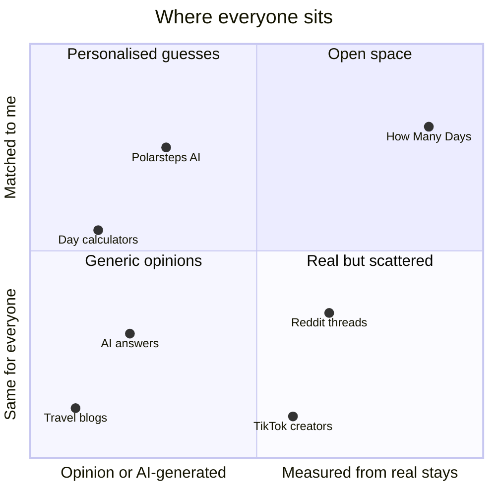

# How Many Days

A website that answers one question instantly: **how many nights should I spend in this town?** Every answer comes from stays logged by real backpackers, not from editors or AI.

> **One-liner:** How Many Days wins by turning the line every travel blog repeats, "people always stay longer than they planned", into a real number for each town. The number is measured from actual stays and matched to your travel style.

**How this file is organised**

- **Part 1: Building the website.** The rules, maths, data, pages, design, stack and workflow. Follow it exactly.
- **Part 2: Product background.** Positioning, competitors, business model, validation, the data-collection form and outreach. Use it for context and copy; build only what Part 1's roadmap asks for.

The founder is new to coding. After every task, explain in plain English what changed and exactly how to check it.

Visual reference: the clickable mockup (Search, Pai city page, Add your stay): https://claude.ai/artifact/1LpN2Mkyq5dmxqSGSuMbjL

---

# Part 1: Building the website

## Product rules (non-negotiable)

If a request conflicts with these, stop and ask before building.

1. **Whole numbers only.** Nights are always whole numbers ("3 nights"). Percentages are whole numbers. No stars, no half stars, no decimals, no scores out of 5 or 10, anywhere in the UI or the data.
2. **The answer leads.** On a city page the first thing anyone sees is the town name and the big number of nights.
3. **The regret number sits beside the answer.** "38% wished they'd stayed longer" is always shown with the answer.
4. **Never guess.** Confidence levels depend on the number of eligible stays (n):
   - n ≥ 30: show one number.
   - 10 ≤ n ≤ 29: show a range ("2–4 nights") labelled "Early data".
   - n < 10: show no number; show "Not enough stays yet. Add yours."
   The same rule applies after a filter is on ("Not enough chill travellers yet").
5. **Verdicts are words, never scores:** Skip it / Fewer nights / About right / More nights.
6. **Every review carries data:** nights stayed, verdict and month. Review text is optional and max 140 characters.
7. **Two separate filters.**
   - The answer filter (Filter button by the town name) changes only the number, the chart and the regret figures.
   - The review filter (pills above the reviews) changes only which reviews show.
   Never link them.
8. **Show the evidence.** Every answer shows its sample size and recency: "142 stays · latest 6 days ago".

## Out of scope (do not build, even if it seems helpful)

- **Star ratings, half stars, numeric scores:** nights are the unit, in whole numbers.
- **Accounts, logins, profiles, followers, feeds, likes, comments:** they need frequent use and friends on the app.
- **Things-to-do lists or attraction pages:** every guide and AI already has them. Tips stay one line per review.
- **AI-generated itineraries or AI-written answers:** competitors already offer them, and they would make our real data look generated.
- **Hostel or restaurant reviews:** Hostelworld owns them. Link out instead.
- **A map as the main screen:** it slows the instant answer. Search comes first.
- **Badges, streaks, points:** they reward fake logs and corrupt the number.
- **Towns outside the launch route:** thin pages destroy trust.

## The maths

All stats logic lives in `lib/stats.ts` as pure functions with unit tests in `lib/stats.test.ts`. UI code never calculates stats itself.

- **Eligible stays:** submitted in the last 24 months; `nightsStayed` 1–10 (10 means "10+"); a verdict is present; the town is matched to `data/towns.json`.
- **Answer (nights):**
  - Take the median of `nightsStayed`.
  - If the median is a whole number, use it.
  - If it ends in .5, round towards what most people wished: up if share(More nights) > share(Fewer nights + Skip it), down if it is lower, up if they are equal.
- **Range (early data):** 25th–75th percentile of `nightsStayed`, each rounded to the nearest whole night. If both ends are equal, show a single number with the "Early data" label.
- **"Most stayed" line:** the same 25th–75th percentile range, shown under the answer when n ≥ 30.
- **Regret shares:**
  - wishedLonger = More nights / n.
  - wishedShorter = (Fewer nights + Skip it) / n.
  - aboutRight = About right / n.
  - Show as whole-number percentages that always sum to 100. Use the largest-remainder method.
- **Skip share:** if Skip it ≥ 10% of n, also show "X% would skip it".
- **Distribution chart:** buckets 1, 2, 3, 4, 5+ nights, as whole-number percentages that sum to 100 (largest remainder). Highlight the bucket that contains the answer; for Early data, highlight every bucket inside the range.
- **Percentiles** use linear interpolation, the same method as Google Sheets' `PERCENTILE`. A range end that lands exactly on .5 rounds outwards (bottom end down, top end up).
- **Under 10 stays** (with or without a filter): no number, no regret percentages, no chart. Only the count of stays.
- **Largest remainder ties:** equal remainders go to the earlier item (longer, right, shorter; or bars left to right).
- **"Today"** for all stats is the build date (`BUILD_DATE`, set in `next.config.ts`), because Next.js 16 doesn't allow reading the clock while prerendering. The site must be rebuilt for "latest X days ago" to move on.
- **When people went:** month shares (largest remainder) from eligible stays that gave a month; hidden under 10 such stays. "Busiest" = up to 3 most common months, in season order (Nov, Dec, Jan).
- **Reviews:** eligible stays that left a tip, newest first, with "X of N stays left a tip".
- **Filters:** a style filter keeps stays whose `styles` include that style, then every rule above runs again on the filtered set.
- **Answer filter results are worked out at build time** for all travellers and every style (`townStatsByStyle`). The page only switches between them; the browser never calculates.

Each rule needs tests, including:
- the .5 tie-break;
- the 10/30 boundaries;
- percentages summing to 100;
- an empty set;
- a filtered set below 10.

## Data

Phase 1 has no database. Data lives in files and pages are built from them.

- `data/raw/form.csv`: the Google Sheet export from the stays form (see Part 2). Never edit by hand; never commit personal data (emails).
- `data/stays.csv`: the normalised output of `npm run import`, one row per stay.
- `data/towns.json`: the canonical town list for the launch route: `{ slug, name, country, route, aliases[] }`.
- `data/sample/`: made-up sample data for development. Every page using it shows a "Sample data" badge.

**Stay (normalised)**

| Field | Type | Notes |
| --- | --- | --- |
| id | string | stable hash of submission + stop index |
| submittedAt | ISO date | from the form timestamp; used for recency |
| townSlug | string | matched via `towns.json` aliases |
| nightsPlanned | int or null | null for "Hadn't planned" |
| nightsStayed | int 1–10 | 10 means "10+" |
| verdict | "skip" \| "fewer" \| "right" \| "more" | |
| month | int 1–12 or null | month of the stay |
| styles | string[] | party, chill, hiking, budget, food, culture |
| tripLength | string or null | "2-4w", "1-3m", "3m+"; null if left blank |
| tip | string or null | max 140 chars, trimmed |

**Importing the form export:**
- The form repeats the "Stop" section, so the export has repeated column groups (town, planned, stayed, verdict, month, tip) in order. Parse them in order.
- Skip empty groups.
- Drop the email column.
- Keep one stay per town per submission.
- Print a report of town names that didn't match `towns.json`, and leave those rows out until an alias is added.

## Pages

| Route | What it shows |
| --- | --- |
| `/` | Search box (filters the town list as you type) and the launch-route towns, each with its answer and regret % |
| `/[town]` | City page: town name + Filter button, answer card (number, range line, evidence line, regret callout), distribution chart, Looking back bar (fewer / same / more), "When people went" month chart, reviews with style pills, next 3 stops on the route |
| `/how-it-works` | How the numbers are calculated, in plain words, including the confidence levels |
| `/add` | Phase 1: a short page linking to the Google Form. Phase 2: our own form |

- **Page title:** "How many days in Pai? 3 nights, from 142 backpackers | How Many Days".
- **Meta description:** written from the same numbers.

## Booking button (deferred)

Not being built for now (founder decision, 2026-11-19). Revisit only when looking to monetise. The notes below are kept for then.

- `lib/booking.ts` exports `bookingUrl(town, nights)`.
- The partner base URL and any affiliate ID come from environment variables (`BOOKING_BASE_URL`, `BOOKING_AFFILIATE_ID`). Never hardcode them.
- The label always uses the current answer: "Find a bed in Pai · 3 nights".
- If no number is shown (n < 10), the button reads "Find a bed in Pai" with no night count.

## Design

Mobile first (design at 390px wide). On desktop, centre a single column with a max width of 560px.

| Token | Value | Use |
| --- | --- | --- |
| background | #DCEEE2 | page (sage green) |
| surface | #FFFFFF | cards |
| border | #C8E0D0 | dividers, unselected pill borders |
| ink | #3A2716 | main text (deep earth brown), primary buttons, the big number |
| text-secondary | #6B5444 | secondary text, warm brown (passes contrast on white and sage) |
| accent | #8A4F24 | brown: section eyebrow labels, "Stop N" labels, review night counts, the answer's chart bar label |
| accent-bar | #A8693A | brown fill: the answer's bar on the chart |
| accent-tint | #F1E4D4 | sand: "Early data" chip |
| accent-text | #4A2810 | text on accent-tint |
| bar | #D3E4D9 | non-highlighted chart bars |
| chip | #E8F3EC | neutral chips |
| slate | #64748B | spare |
| brand | #17754C | strong green: the name, "More nights" (bar, %, regret number), busiest months, selected pill borders |
| brand-tint | #BDEBD1 | mint: selected pills, active Filter button, range band |
| brand-text | #3A2716 | text on brand-tint |
| fewer | #B3412E | earthy red: "Fewer nights" bar and % |
| fewer-tint / fewer-text | #F6E0DB / #7A2A1D | "Fewer nights" and "Skip it" chips, "would skip it" line |
| right | #8FCB9F | soft green: "About right" bar (fill only; too light for text) |
| right-tint / right-text | #E3F2E6 / #2F6B3F | "About right" chip and % |
| more-tint / more-text | #D6EFDF / #0F4F33 | regret strip ("wished they'd stayed longer") and "More nights" chip |

- **Fonts:** Inter for everything (headings, numbers and body), via `next/font`.
- **Shape:** white cards on the sage page, no borders, radius 20px (28px for the answer hero). No shadows, no gradients, no emoji. Icons are simple stroke SVGs.
- **Layout:** editorial. Filter button top left, then "COUNTRY · STOP N OF 26" and a 68px town name. The answer hero has the big number, a 1–10+ range ruler, the evidence line and a full-width regret strip. Each later section has a brown eyebrow label and a bold heading over a thin brown rule ("The spread", "Timing", "In their words", "Keep going"). Reviews are one list with a big night count on the left. Next stops scroll sideways. 40px between sections.
- **Answer number:** 148px (112px for a range), Inter, weight 700, tight letter spacing.
- **Accessibility:**
  - touch targets at least 44px;
  - real `<button>` and `<a>` elements;
  - filter pills use `aria-pressed`;
  - text contrast at least 4.5:1;
  - charts have a text alternative (the percentages are visible text).
- **Voice:** see Brand and voice in Part 2.

## Stack

- Next.js (App Router) + TypeScript, pages generated at build time from the data files
- Tailwind CSS v4 with the tokens above in `app/globals.css` (`@theme` block; v4 has no config file)
- Vitest for tests
- Hosted on Vercel
- Next.js 16 differs from older versions: see `AGENTS.md` and read the guide in `node_modules/next/dist/docs/` before writing Next.js code.
- Ask before adding any other dependency. Charts are plain HTML/CSS bars; no chart library.

**Commands** (keep this list current as scripts are added):

- `npm run dev`: local site at http://localhost:3000
- `npm run build`: production build (must pass before a task is done)
- `npm test`: unit tests (must pass before a task is done)
- `npm run test:watch`: re-runs tests as files change
- `npm run lint`: lint
- `npm run import`: `data/raw/form.csv` → `data/stays.csv` with an unmatched-towns report

**Folders**

```
app/            routes and page components
components/     UI pieces (TownAnswer, AnswerCard, DistributionChart, RegretBar, FilterPanel, StylePills, MonthChart, TownReviews, ReviewList, NextStops)
lib/            stats.ts, data.ts (loading + validation), towns.ts, labels.ts (display words), build-date.ts, csv.ts, form-import.ts (import logic)
data/           towns.json, stays.csv, raw/ (git-ignored), sample/ (stays.csv, form-export.csv)
scripts/        import-form.ts
```

## How to work on this project

1. **One task at a time.** If a task touches more than one file or adds a feature, write a short plan first and wait for approval.
2. **Smallest working change.** Prefer a small working slice over a big unfinished one.
3. **Tests for the maths.** Any change to `lib/stats.ts` comes with tests. Run `npm test` and `npm run build` before saying a task is done.
4. **Check the phone layout.** Check pages at 390px wide and on desktop. Fix any console errors.
5. **No invented data.** Development uses `data/sample/` only, clearly labelled. Never make up numbers for real towns.
6. **Commit after each working step,** with a clear message ("Add confidence levels to answer card").
7. **Explain like a teammate.** Finish every task with: what changed, why, and the exact steps to see it working (which URL, what to click, what you should see).
8. **Record decisions.** When the founder makes a product decision, add it to the Decisions log below.

**Definition of done**

- tests pass;
- build passes;
- looks right at 390px and desktop;
- no console errors;
- the founder has the steps to check it.

## Roadmap

**Phase 1: static site from form data** (current)

1. Scaffold Next.js + TypeScript + Tailwind + Vitest, fonts, design tokens, a basic layout.
2. Add `data/towns.json` for the launch route and `data/sample/stays.csv` (about 60 made-up stays across 3 towns, labelled sample).
3. Build `lib/data.ts` (load + validate stays) and `scripts/import-form.ts` (`npm run import`).
4. Build `lib/stats.ts` with full tests (answer, rounding, range, regret shares, distribution, confidence levels, filters).
5. Build the city page: answer card, evidence line, regret callout, distribution chart, Looking back bar, reviews.
6. Add the answer filter (Filter button and panel) and the review filter (style pills), kept separate.
7. Build the home page with search and the town list.
8. ~~Add the booking button~~ Deferred: discuss when looking to monetise.
9. Add `/how-it-works`, `/add`, and the empty and early-data states.
10. Deploy to Vercel.
11. Swap sample data for the real form export.

**Phase 2:** our own "Add your stay" form and a real database (only after the form proves demand).

**Phase 3:** the signature features in Part 2:
- link preview images per town;
- Planned → Stayed → Wished;
- season-aware answers;
- "Steal a night from…" route advice.
- Idea, parked (not committed): traveller profiles and friends (see who visited a place, a friend's countries). Out of scope until the form proves demand; needs identities, logins, a database and privacy consent. Decide with real numbers.

## Decisions log

- 2026-11-19: Whole numbers only. No stars, no half stars, no decimals.
- 2026-11-19: Product name is How Many Days; the unit on the page is nights.
- 2026-11-19: Launch on one route (Southeast Asia loop, 20–30 towns), website before app.
- 2026-11-19: Design tokens live in `app/globals.css` because Tailwind v4 replaced the config file. A test (`lib/design-tokens.test.ts`) keeps them matching the Design table.
- 2026-11-19: Launch route is the Southeast Asia loop, 26 towns in `data/towns.json` (route `se-asia-loop`). Left out for now: Ayutthaya, Kanchanaburi, Koh Samui, Huay Xai, Nong Khiaw, 4000 Islands, Mui Ne.
- 2026-11-19: One Cat Ba page; "Ha Long Bay", "Halong" and "Lan Ha Bay" count as Cat Ba.
- 2026-11-19: One Krabi page covering Ao Nang and Railay.
- 2026-11-19: Sample data uses Pai (34 stays), Chiang Mai (18) and Hoi An (8) so it covers all three confidence levels. Always badged "Sample data".
- 2026-11-19: Import: a tip over 140 characters is dropped but the stay is kept; the report lists it.
- 2026-11-19: Import: the same town twice in one submission keeps the first stay; the report lists the rest.
- 2026-11-19: Import: stops from trips outside Southeast Asia are left out and counted in the report, not listed as unmatched towns.
- 2026-11-19: Import: form timestamps are read as day/month/year unless the file proves month/day/year; the report says which.
- 2026-11-19: The site uses `data/stays.csv` once it has rows, otherwise `data/sample/stays.csv` with the "Sample data" badge. A bad row in either stops the build.
- 2026-11-19: `data/raw/` is git-ignored (except its README) so form exports with emails are never committed.
- 2026-11-19: Under 10 stays, hide the regret percentages and the chart too, not just the number. Show only the count.
- 2026-11-19: Percentiles use the Google Sheets `PERCENTILE` method so ranges can be checked in the sheet.
- 2026-11-19: Range ends on an exact .5 round outwards (bottom down, top up) so the range never claims more certainty than the data has.
- 2026-11-19: No booking button for now. Revisit when looking to monetise. Roadmap task 8 is deferred.
- 2026-11-19: For Early data, the chart highlights every bar inside the range.
- 2026-11-19: Traveller profiles and friends stay out of scope for Phase 1 (founder chose option A). Parked as a Phase 3 idea in the roadmap.
- 2026-11-19: Reviews show only stays that left a tip, newest first, with "X of N stays left a tip".
- 2026-11-19: The month chart is headed "When people went" (honest: it's when people visited, not when it's best). No season labels until data supports them.
- 2026-11-19: Answer lead line: "Most people stay" for 30+ stays, "People stayed" for Early data.
- 2026-11-19: Next stops: the next 3 towns in `towns.json` order, wrapping round the loop, each with its own answer. No travel times (no data for them).
- 2026-11-19: Answer filter is pick-then-apply, as in the mockup: choose a style, then "Show answer · N stays". Reset returns to all travellers.
- 2026-11-19: The answer filter does not change "When people went" (rule 7 lists only the number, the chart and the regret figures).
- 2026-11-19: Filters are not saved in the web address for now. Revisit with link-preview images (Phase 3).
- 2026-11-19: Font changed to Inter for everything (founder picked it from a side-by-side comparison as the most natural). Space Grotesk removed.
- 2026-11-19: Added a brand green (#15803D) for the name, selected pills, the active Filter button, primary buttons and "About right". Orange stays for regret and the answer's chart bar.
- 2026-11-19: The Filter button sits top left, above the country and town name. The filter panel stays hidden until it is tapped.
- 2026-11-19: Colourway: sage page, white cards, forest-green text, mint highlights, pumpkin orange for regret (option "L1", from the founder's Forest / Jungle / Pumpkin reference, made lighter twice).
- 2026-11-19: Layout refresh to look less generic: poster-style hero with a range ruler, editorial section labels, list-style reviews, sideways next stops, more spacing.
- 2026-11-19: Brown replaces pumpkin orange (founder request), and is used more: regret strip, highlighted bars, section labels, stop labels, review night counts, dividing lines.
- 2026-11-19: Text is deep earth brown, not forest green. Verdict colours are a traffic light: Fewer nights / Skip it = earthy red, About right = soft green, More nights = strong green, used the same in the Looking back bar, review chips and the regret strip. Brown stays for labels, lines and the answer's chart bar.
- 2026-11-19: Review pills only show styles with at least one tip. The answer filter always shows all six styles, with their stay counts.

## Founder checklist

- [x] Whole numbers only: no stars, no half stars, no decimals
- [ ] Add "How many nights had you planned?" to the form before collecting any data
- [x] Pick the launch route and its 20–30 towns
- [ ] Build the Google Form and link it to a Sheet
- [ ] Post the form in Facebook groups and Discords; post the discussion thread on Reddit
- [ ] Reach 100+ responses with a median of 6+ stops
- [ ] Run the three "is it different?" tests
- [ ] Publish the first route guide
- [ ] Check the domain and app-store name

---

# Part 2: Product background

## The idea

1. Search a town and get a big answer, such as "Pai: 3 nights". Under it: the % who wished they'd stayed longer, and a chart of how long people stayed.
2. Filter the answer by travel style (Party, Chill, Hiking, Budget).
3. Read short reviews, each carrying nights, verdict and month.
4. Tap "Find a bed · 3 nights" to open a hostel search with dates filled in. Booking commissions are the main revenue.

It started as "Letterboxd for travellers". That idea scored low: people travel a few times a year, social features are worthless without friends on the app, and other apps already own each part. How Many Days keeps the one real gap: a trustworthy answer to "how long should I stay?".

| Problem | Letterboxd for travellers | How Many Days |
| --- | --- | --- |
| How often people use it | Needs weekly visits; people travel a few times a year | New visitors arrive every time someone plans a trip |
| Cold start | Social features worthless until friends join | A city page is useful to its first reader |
| Saturation | Another review site | A number nobody else has: nights plus regret |
| Money | Subscriptions from people who rarely open it | A booking link at the moment of decision |
| Difficulty to build | Feeds, maps, moderation | A form, a database and one page template |

## Where everyone sits



- **Travel blogs:** one writer's trip, the same answer for everyone. They keep describing the exact effect we measure: Thai Holiday Guide says 2–3 nights is the sweet spot, then adds that many visitors plan two nights and stay a week. Nobody puts a number on it.
- **Editorial "how many days" sites** (Days in a City, The Better Vacation calculators): opinions, mostly big cities.
- **AI answers:** a blend of those blogs, with no way to see where the answer came from.
- **Polarsteps AI planner:** the closest competitor (20M travellers). It asks who's coming, your travel style and trip length, and warns when a plan is too ambitious for your nights. But its answers are generated and stay inside your own plan.
- **Reddit:** real experiences, scattered across dozens of comments.
- **TikTok:** one person's trip, made to entertain.
- **Hostelworld:** owns the bed, not the "how long" decision. A partner for the booking link.
- **Beli and Corner:** social place apps for your home city, not for trips.
- **Ideas checked and ruled out (crowded):** Letterboxd for concerts, laptop-friendly café finders, Schengen day trackers, hostel events software.
- **Open space:** an answer measured from real stays, matched to you, with the evidence shown.

## The one thing to own

**The regret number:** the only place that tells you how many nights people like you actually stayed, and whether it was enough.

- **AI:** it can summarise data but can't create first-hand data. A cited figure like "38% of 142 backpackers wished they'd stayed longer" is what AI answers like to quote.
- **Blogs:** they would need a logging product and thousands of submissions.
- **Polarsteps:** the real threat, since it already knows nights per stop. But it doesn't ask "was it enough?", and its product is a private diary. Our edge is the verdict question plus dense data on one route. Get there first.
- **Why being quoted matters:** Pew found click-through fell from 15% to 8% when AI summaries appear. The number has to be worth quoting, and the page has to offer something to do (the booking button).

## Signature features

| Feature | What the user sees | Why it's different | When |
| --- | --- | --- | --- |
| Planned → Stayed → Wished | "Planned 2 → Stayed 3 → Wished 4" under the big number | Shows how plans go wrong; nobody else has it | Phase 3 (needs the planned-nights question) |
| "For people like you" by default | One tap picks your style on the first visit; answers open tailored | Blogs and AI give everyone the same answer | Phase 1 extension (choice saved in the browser) |
| Tap a bar, meet the people | Tapping the "5 nights" bar shows reviews from people who stayed 5 | The chart becomes proof, not decoration | Phase 1 extension |
| Season shifts the answer | "March: 2 nights (smoky season)" | Blogs and AI ignore when you're going | Phase 3 (needs enough stays per season) |
| "Steal a night from…" | "People who wished for longer here usually cut Chiang Mai short" | Advice about the whole route | Phase 3 (needs route-level data) |

## Trust

- **One quiet line under the answer:** "142 stays · latest 6 days ago · mostly Nov–Feb".
- **Confidence levels:** see product rule 4. Refusing to guess is something AI won't do.
- **The real chart:** the messy chart is the proof. A made-up number doesn't come with a lopsided distribution.
- **Recency:** only count stays from the last 24 months, and say so on the page.
- **Anti-gaming:**
  - one stay per town per trip;
  - no posting by hostels;
  - an unusual run of identical stays gets held for a check.

## Shareability: the link preview

In a group chat asking "how long should we do in Pai?", someone pastes the link and the preview image gives the answer. Nobody even needs to click.

- **Size:** 1200×630, white background.
- **Top left:** "PAI, THAILAND".
- **Centre:** a huge "3 nights".
- **Below, in orange:** "38% wished they'd stayed longer".
- **Bottom:** "from 142 backpackers · howmanydays.[domain]".
- **If a style filter is on:** a pill reading "for chill travellers".

A post-trip Instagram route card comes later.

## Brand and voice

**Positioning:** for backpackers deciding how long to stay, How Many Days is the only guide built from what travellers actually did, so you can plan your nights on real stays instead of opinions.

**Taglines:**
1. Everyone says 2–3 days. Here's what people actually did.
2. Stay the right amount of time.
3. Real nights. Real backpackers.
4. Planned two, stayed a week? Know before you book.
5. How long is enough?

**Tone:** the friend in the hostel common room who's just come from there. Blunt, specific, a little funny.

- **Compared with TripAdvisor:** no stars and no essays. A whole number and a verdict.
- **Compared with travel blogs:** no 2,000-word intro and no "it depends on you". The answer comes first.
- **Compared with AI chatbots:** it never hedges, it shows its working ("142 stays"), and it admits when it doesn't know. Example: "Nobody's logged Soppong yet. Been? You're the first data point."

## Business model

| Revenue stream | Fit | Why |
| --- | --- | --- |
| Booking commissions | Best | High intent once someone picks "3 nights"; small per booking, so it needs volume |
| Trip passes | Good | Matches how backpackers use apps; Hostelworld's US pass is $5.99 a week or $12.99 a month |
| Printed route posters | Proven | Polarsteps' printed books are its core business |
| Sponsored lists | Later | Hostels would pay, but it risks trust |
| Data for tourism boards | Years away | Don't plan around it |

## Validation plan

### Is there demand? (2 weeks, no code)

The thresholds below are rules of thumb.

| Test | How | Continue if | Stop if |
| --- | --- | --- | --- |
| 1. Nights form | Google Form asking for the last 8–10 stops | 100+ responses, median 6+ stops | People quit after 2–3 stops |
| 2. Landing page | One page, shared in groups and Discords | 200+ signups, 15%+ of visitors | Under 5% sign up |
| 3. First route guide | Turn form answers into a "how long to stay" guide and post it | Lots of saves, comments, shares | Little engagement |
| 4. Content test | 5 short videos rating towns by nights | One reaches ~10K views, or "what app is this?" | Nothing gets traction |
| 5. Between-trip interviews | Ask 10 people back from a long trip which travel apps they opened in the last 30 days | 4+ describe a regular habit we could own | 2 or fewer |

If 1 and 2 both fail, drop the idea. If 3 and 4 pass, there's a growth loop worth building.

### Do people see it as different? (under a week each)

| Test | How | Pass | Fail |
| --- | --- | --- | --- |
| Blind card test | Show an AI-style card ("Pai: 2–3 days") vs ours ("3 nights · 38% wished longer · 142 stays"), unbranded, to 50 people (PickFu or Discords) | 70%+ pick ours, citing real people or real data | Under 50% pick ours |
| Five-second test | Show the city page for 5 seconds to 15 backpackers; ask what it is and how it differs from TripAdvisor or ChatGPT | 10+ say "from real travellers' stays" unprompted | 5 or fewer, or "a travel guide" |
| Group-chat test | Drop one city's link preview into 5 backpacker chats | 3+ unprompted "is there one for X?" in a week | Polite thanks only |

## Google Form (data source for `data/raw/form.csv`)

**Title:** How many nights was it worth? (2 min)

**Description:** I'm building a free guide to how long to stay in each town, based on real backpackers, not blog guesses. Log the stops from your last trip.

**Section 1: Your trip**
1. Where was this trip? *(multiple choice)* Southeast Asia / South America / Central America / Europe / Other
2. Your travel style *(checkboxes)* Party / Chill / Hiking & outdoors / Budget / Food / Culture
3. How long was the whole trip? *(multiple choice)* 2–4 weeks / 1–3 months / 3+ months

**Section 2: Stop 1** (duplicate about 10 times)

4. Town *(short answer, required)*
5. How many nights had you planned? *(dropdown, required)* 1, 2, 3 … 9, 10+, Hadn't planned
6. Nights you actually stayed *(dropdown, required)* 1, 2, 3 … 9, 10+
7. Looking back, it deserved… *(multiple choice, required)* Skip it / Fewer nights / About right / More nights
8. Month you were there *(dropdown, optional)*
9. One tip for the next person *(short answer, optional)*
10. Add another stop? *(multiple choice)* Yes, go to the next stop / No, go to the final section

**Final section**

11. Would you log your stops on your next trip if it built you a free route map? *(multiple choice)* Yes / Maybe / No
12. Want the finished guide? Leave your email *(short answer, optional)*

**Setup:**
- On question 10, use "Go to section based on answer".
- Turn off "Restrict to users" and "Collect email addresses".
- Link the form to a Google Sheet; export it as CSV to `data/raw/form.csv`.
- Every dropdown is whole numbers only.

## Outreach posts

**Subreddit rules:**
- **r/solotravel:** no longer accepts survey links, and removes AI-generated posts as spam. Rewrite the Reddit post in your own words.
- **r/backpacking:** bans advertising, self-promotion and surveys. Posts need a "Travel" flair and a paragraph about your trip.
- **r/travel:** turns surveys away and points posters to r/samplesize.
- **Everywhere else:** use the form link in Facebook backpacker groups, travel Discords, hostel group chats and your own socials, after checking each group's rules.

**Reddit discussion post (no link)**

```
Title: Which stop did you stay too long (or not long enough) in?

On my [TRIP, e.g. 3 months in SE Asia] I gave [TOWN] [X] nights and left wishing I'd had [more / fewer]. [One honest line on why.]

Planning my next trip, I've realised the hard part isn't where to go, it's how long to stay. Every blog says "2–3 days" for everywhere.

So what's yours? If you can, use this format so they're easy to compare:

Town – nights planned – nights stayed – should've been more / fewer / about right – why

I'll tally everything and post the results back here, so we've got real numbers instead of guesses.
```

**Form-link post (Facebook groups, Discords)**

```
Quick one for anyone who's backpacked in the last couple of years.

I'm building a free guide that answers one question: how many nights should you actually spend in each town? It's based on what real backpackers did, not blog guesses.

It takes about 2 minutes to log your stops: [FORM LINK]

For each stop it asks how many nights you planned, how many you stayed, whether it was enough, and one optional tip. No sign-up needed.

Starting with Southeast Asia, so those trips are extra helpful. I'll share the results back here once I've got enough.
```

## Links

- Clickable mockup: https://claude.ai/artifact/1LpN2Mkyq5dmxqSGSuMbjL
- Project brief doc: https://claude.ai/artifact/VK5Yps6RTbstetZKUAxvrQ

## Sources

- [Thai Holiday Guide: things to do in Pai](https://www.thaiholidayguide.com/things-to-do-in-pai/)
- [Polarsteps Travel Planner](https://www.polarsteps.com/travel-planner)
- [Polarsteps help: planning nights](https://support.polarsteps.com/hc/articles/24265886208914)
- [Polarsteps: 20 million travelers](https://www.polarsteps.com/news/20-million-travelers-and-counting-tech-success-story-polarsteps-celebrates-its-fast-growing-community)
- [AI search and destination discovery (cites Pew)](https://www.thinkdigital.travel/opinion/ai-search-and-destination-discovery-whats-changing)
- [Hostelworld Social Pass](https://www.hostelworld.com/blog/?p=1270751)
- [Days in a City](http://www.daysinacity.com/)
- [The Better Vacation trip calculators](https://thebettervacation.com/how-many-days-do-you-need-free-trip-calculator/)
- [PickFu pricing](https://www.pickfu.com/help/how-does-pickfu-s-pricing-work)
